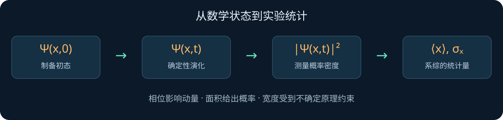

# 第一章 · 波函数：从“它在哪里”到“我们能预测什么”

> 依据本目录 Griffiths《量子力学概论》第二版中文译本第一章，按 §1.1—§1.6 重组为教学笔记。原书第一章位于 **PDF 第 6—20 页**（阅读器从 1 开始计数），第二章始于 PDF 第 21 页。以下是独立讲解，公式采用统一的现代排版；演示中的高斯波包、傅里叶分布与数值检验是为理解本章添加的教学拓展，并非原书逐段翻译。
>
> **学习入口：** 双击 [lab.html](lab.html)。不需联网、不需安装依赖。建议先猜结果，再拖滑块，最后回来读推导。

## 怎么学这一章

准备：复数的模与共轭、导数、定积分、分部积分。第一次学习可分三次：① §1—3，理解概率；② §4—5，理解演化与算符；③ §6—8，亲手做实验与练习。目标不是背六条公式，而是打通一条链：

**初态 Ψ → 薛定谔演化 → 概率密度 → 测量统计 → 平均值与不确定度。**

## 1. §1.1：量子力学首先更换了“要算的东西”

经典力学求一条轨迹 $x(t)$，初始位置和速度决定后来的运动。这里考虑非相对论、一维、无自旋粒子，量子力学求的是复函数 $\Psi(x,t)$：

$$
i\hbar\frac{\partial\Psi}{\partial t}
=\left[-\frac{\hbar^2}{2m}\frac{\partial^2}{\partial x^2}+V(x,t)\right]\Psi.
$$

这就是含时薛定谔方程。$m$ 是质量，$V$ 是势能，$\hbar=h/(2\pi)$。左边管理时间变化；右边的二阶空间导数对应动能，$V\Psi$ 对应势能。不要把空间曲率直接等同于概率密度的曲率：被求导的是复波函数。

给定物理上允许的初始波函数、势能及适当边界条件，方程决定后续波函数。**波函数的演化可以确定，单次测量结果仍然可以随机**。 这两件事并不矛盾：天气模型预测明天下雨概率，不等于指定每一滴雨落在哪里；这个类比只解释“预测分布”，不意味着量子随机性必然来自未知经典变量。

### 复数到底做什么？

写成 $\Psi=u+iv$，则 $\Psi^*=u-iv$，$|\Psi|^2=u^2+v^2$。波函数不是实数高度的普通水波；实部可以为负，概率密度不能为负。相位描述复平面中的方向，后面会看到它能改变动量。

> 先猜：把整个波函数乘以 $i$，位置概率会变吗？不会，因为 $|i\Psi|^2=|\Psi|^2$。

## 2. §1.2：Born 规则，把波函数接到实验上

$$
\rho(x,t)=|\Psi(x,t)|^2,\qquad
P(a\le x\le b;t)=\int_a^b|\Psi(x,t)|^2\,dx.
$$

记住：**曲线高度是密度，曲线下面积才是概率**。一维中 $[\rho]=L^{-1}$，$[\Psi]=L^{-1/2}$；密度可以大于 1，但任何区间的概率必须在 0 和 1 之间。对通常的连续位置分布，精确单点概率为零，不代表粒子不会在任何地方被探测到；实际仪器都有有限分辨率。

### 实验室 A：一粒一粒地积累图像

打开网页，在“Born 采样”中点“再测 100 次”。每个点代表**重新制备同一个初态后的一次位置测量**。少量样本可能偏得很明显，积累后直方图接近 $|\Psi|^2$；它不必单调变好，也不会在有限次后完全吻合。

这与对同一个粒子立即连续测量不同。理想位置测量会改变状态；教科书用“坍塌”描述这一更新。精确位置本征态是理想化的、不可归一化的对象；现实中只能局域到有限宽度。网页只模拟独立制备的系综采样，**没有模拟测量后的坍塌动力学**。

本章采用教科书的统计诠释和理想测量语言。不同诠释对测量前发生什么有不同描述；仅凭 Born 规则，不能证明所有隐变量理论都被排除。

## 3. §1.3：概率工具箱——平均值不等于“最可能”

| 问题 | 离散随机量 $j$ | 连续随机量 $x$ |
|---|---|---|
| 总概率 | $\sum_jP_j=1$ | $\int\rho(x)dx=1$ |
| 期待值 | $\langle j\rangle=\sum_jjP_j$ | $\langle x\rangle=\int x\rho(x)dx$ |
| 函数的平均 | $\langle f(j)\rangle=\sum_jf(j)P_j$ | $\langle f(x)\rangle=\int f(x)\rho(x)dx$ |
| 方差 | $\sigma_j^2=\langle j^2\rangle-\langle j\rangle^2$ | $\sigma_x^2=\langle x^2\rangle-\langle x\rangle^2$ |

期待值是同态系综的统计平均；众数是密度或概率最高的位置；中位数把概率分成各半。三者不一定相同，期待值甚至可能是单次测量不可能出现的值：公平骰子的平均是 3.5，却没有 3.5 点。

### 为什么标准差要先平方？

平均偏差总是零：$\langle x-\langle x\rangle\rangle=0$。正负抵消会掩盖宽度，所以先平方：

$$
\begin{aligned}
\sigma_x^2&=\langle(x-\mu)^2\rangle\\
&=\langle x^2-2\mu x+\mu^2\rangle\\
&=\langle x^2\rangle-\mu^2,\qquad \mu=\langle x\rangle.
\end{aligned}
$$

标准差与 $x$ 同单位，是一组测量结果的分布宽度，并非均值估计误差。独立样本的样本均值，其标准误差约为 $\sigma_x/\sqrt N$，因此增加样本能改善均值估计，却不会让态本身的位置分布变窄。

### 原书例 1.1：随机拍摄一块下落的石头

石头从静止下落高度 $h$，在整个下落时间内均匀随机拍照。设 $x$ 是已经下落的距离，$T=\sqrt{2h/g}$，则

$$
x=\frac12gt^2,\qquad \rho(x)dx=\frac{dt}{T},\qquad
\rho(x)=\frac{1}{2\sqrt{hx}}\quad(0<x<h).
$$

它在顶部速度慢，花的时间多，所以照片更常出现在小 $x$，并非位置均匀。

$$
\int_0^h\rho dx=1,\qquad
\langle x\rangle=h/3,\quad\langle x^2\rangle=h^2/5,\quad
\sigma_x=2h/\sqrt{45}.
$$

密度在 $x=0$ 发散，但可积，概率依然正常。例如前 $1\%$ 高度的概率是 $\sqrt{0.01}=10\%$。变量变换时，**概率守恒，密度要乘雅可比**。这是后续从位置到其他变量时很有用的直觉。

## 4. §1.4：归一化——把“相对权重”变成概率

若 $\Psi=A f(x)$，则

$$
1=|A|^2\int_{-\infty}^{\infty}|f(x)|^2dx,
\qquad |A|=\left(\int |f|^2dx\right)^{-1/2}.
$$

归一化只确定 $A$ 的模，整体常相位仍可自由选择。零函数或平方积分发散的函数不能归一化为整个实轴上的单粒子态。无限延伸的平面波是重要的广义态，可用来展开波包，但不能当作已经归一化的位置概率分布。

### 本教程的主角：高斯波包

$$
\Psi(x,0)=\frac{1}{(2\pi s^2)^{1/4}}
\exp\left[-\frac{(x-x_0)^2}{4s^2}+ik_0(x-x_0)\right],\qquad s>0.
$$

取模平方后，相位消失：

$$
\rho(x,0)=\frac{1}{\sqrt{2\pi}s}
\exp\left[-\frac{(x-x_0)^2}{2s^2}\right].
$$

因此 $\langle x\rangle=x_0$，$\sigma_x=s$。注意波函数指数分母是 $4s^2$，密度指数分母是 $2s^2$；混淆它们会导致不确定度差一个 $\sqrt2$。

### 为什么归一化一次就够了？

对实势能，薛定谔方程及其共轭给出

$$
\partial_t|\Psi|^2+\partial_x J=0,\qquad
J=\frac{\hbar}{m}\operatorname{Im}(\Psi^*\partial_x\Psi).
$$

这是概率的连续性方程：一个小区域的概率增加，只能来自净流入。

$$
\frac{d}{dt}\int_a^b\rho dx=J(a,t)-J(b,t).
$$

若整个实轴两端没有净概率流出（通常要求波函数及相关边界项充分衰减），总概率不变。在封闭有限区域，需采用相容的自伴边界条件。这里不能仅凭“函数趋零”就忽略所有导数边界项。

**拓展：**原书补充题 1.15 引入 $V=V_0-i\Gamma$、$\Gamma>0$，这时 $dP/dt=-2\Gamma P/\hbar$，故 $P(t)=P(0)e^{-2\Gamma t/\hbar}$，寿命 $\tau=\hbar/(2\Gamma)$。这是有效衰减模型；实势能守恒证明的前提已改变。

## 5. §1.5：动量藏在相位里

位置期待值为 $\langle x\rangle=\int\Psi^*x\Psi dx$。由连续性方程，积分分部并令边界项消失：

$$
\frac{d\langle x\rangle}{dt}=\int J dx
=\frac1m\int\Psi^*(-i\hbar\partial_x)\Psi dx.
$$

因此在这里的标量势模型中

$$
\hat x=x,\quad \hat p=-i\hbar\partial_x,\quad
\langle p\rangle=\int\Psi^*\hat p\Psi dx,
\qquad \frac{d\langle x\rangle}{dt}=\frac{\langle p\rangle}{m}.
$$

算符是一条操作指令：$\hat x$ 让后面的函数乘 $x$；$\hat p$ 让它先求导再乘 $-i\hbar$。导数不能随意穿过其他因子，通常 $\hat x\hat p\ne\hat p\hat x$。

### 高斯例子：同一张位置照片，不同的运动

对上面的高斯，

$$
\partial_x\Psi=\left[-\frac{x-x_0}{2s^2}+ik_0\right]\Psi,
\qquad \langle p\rangle=\hbar k_0.
$$

奇函数积分使第一项平均为零。乘上 $e^{ik_0(x-x_0)}$ 不改变 $|\Psi|^2$，却改变平均动量。网页中固定宽度，改变 $k_0$：橙色密度不变，蓝绿波纹变密，动量分布平移。

整体相位 $e^{i\alpha}$ 不影响物理预测；随位置变化的相位可能改变动量与概率流。**同一个位置分布不唯一确定量子态。**

### 算符的正确用法

$$
\langle p^2\rangle=\int\Psi^*(-\hbar^2\partial_x^2)\Psi dx,
\qquad
\langle T\rangle=\frac{\langle p^2\rangle}{2m}.
$$

$\langle p^2\rangle$ 不是 $\langle p\rangle^2$。对适当边界条件，分部积分可把动能写成 $\hbar^2/(2m)\int|\partial_x\Psi|^2dx\ge0$。对于同时含 $x,p$ 的经典函数，不能忽略量子算符的排序问题；后面的形式理论会系统处理它。

Ehrenfest 定理还给出

$$
\frac{d\langle p\rangle}{dt}=-\langle V'(x)\rangle.
$$

它连接经典与量子，但一般 $\langle V'(x)\rangle\ne V'(\langle x\rangle)$，所以期待值不总是精确沿一条经典轨迹运动。

## 6. §1.6：不确定原理——把波压短，就要加入更多波数

长长的单色波，波长明确，位置不集中；短促的波包，位置集中，却需要许多不同波数叠加。用 $p=\hbar k=h/\lambda$，波数的分散对应动量的分散。

$$
\boxed{\sigma_x\sigma_p\ge\hbar/2}
$$

这是同一个态的位置分布与动量分布标准差的约束。两种分布通常在分别制备的同态系综上测量。它不等于仪器误差公式，也不需要借助“人看了一眼，粒子被撞了一下”来成立。

### 教学拓展：高斯把下限变成可见的曲线

取傅里叶变换约定

$$
\phi(p)=\frac1{\sqrt{2\pi\hbar}}\int e^{-ipx/\hbar}\Psi(x)dx.
$$

则 $|\phi(p)|^2$ 也是归一化高斯，平均 $p_0=\hbar k_0$，标准差 $\sigma_p=\hbar/(2s)$。所以

$$
\langle p^2\rangle=\hbar^2k_0^2+\frac{\hbar^2}{4s^2},\qquad
\sigma_x\sigma_p=s\frac{\hbar}{2s}=\frac\hbar2.
$$

把宽度减半，动量宽度加倍；改变 $k_0$ 只会平移动量中心，不改变标准差。网页采用无量纲单位 $\hbar=m=1$；所有数值都以选定单位表示，不是直接用米和千克。

### 可选：用三行数学看见下限从哪里来

令 $A=(x-\langle x\rangle)\Psi$，$B=(\hat p-\langle p\rangle)\Psi$，对归一化且在所需算符定义域中的态，Cauchy–Schwarz 不等式给出

$$
\sigma_x^2\sigma_p^2\ge|\langle A|B\rangle|^2
\ge[\operatorname{Im}\langle A|B\rangle]^2.
$$

由 $[\hat x,\hat p]=i\hbar$ 得 $\operatorname{Im}\langle A|B\rangle=\hbar/2$，于是得到下限。它是态和算符结构的结果。

## 7. 让它动起来：自由波包会一边走，一边散开

下面是本章概念的拓展实验，并不要求现在掌握第二章的解方程技巧。令 $V=0$，定义

$$
q=1+i\frac{\hbar t}{2ms^2},\qquad v_0=\frac{\hbar k_0}{m}.
$$

高斯的精确自由演化为

$$
\Psi(x,t)=\frac{(2\pi s^2)^{-1/4}}{\sqrt q}
\exp\left[-\frac{(x-x_0-v_0t)^2}{4s^2q}
+ik_0(x-x_0)-i\frac{\hbar k_0^2t}{2m}\right].
$$

由它直接读出

$$
\langle x\rangle=x_0+v_0t,\qquad
\sigma_x(t)=s\sqrt{1+\left(\frac{\hbar t}{2ms^2}\right)^2},\qquad
\sigma_p(t)=\frac{\hbar}{2s}.
$$

**预测后再播放：** 初始包越窄，动量越分散，之后通常扩散越快。没有外力，平均动量及其分布保持不变；位置分布却变宽。这不意味着概率流失——峰值降低正好补偿宽度增加。

$$
\sigma_x(t)\sigma_p(t)=\frac\hbar2\sqrt{1+\left(\frac{\hbar t}{2ms^2}\right)^2}.
$$

只有此处的初始、无二次相位的高斯在 $t=0$ 取等号。后来它仍是高斯，却出现位置与动量关联，乘积大于下限。“凡是高斯永远取等号”是错误的说法。

网页位置横轴跟随均值，且随宽度调整：请看图下的横轴范围，避免把自动缩放误认为波包没有移动或没有扩散。动量图也随参数调整范围。采样图固定对应 $t=0$ 的态。

## 8. 练习：先解释，再计算

### A · 归一化与尾部（对应本章归一化主题）

$\Psi(x)=Ae^{-\lambda|x|}$，$\lambda>0$。求 $A$、$\langle x\rangle$、$\sigma_x$ 及 $P(|x|>\sigma_x)$。

展开答案与推导

$1=2|A|^2\int_0^\infty e^{-2\lambda x}dx=|A|^2/\lambda$，可取 $A=\sqrt\lambda$。偶对称使 $\langle x\rangle=0$。利用 $\int_0^\infty x^2e^{-ax}dx=2/a^3$，得到 $\langle x^2\rangle=1/(2\lambda^2)$，$\sigma_x=1/(\sqrt2\lambda)$。尾部概率 $e^{-2\lambda\sigma_x}=e^{-\sqrt2}\approx0.2431$。标准差不等于分布的边界。

### B · 相位侦探

$\Psi_1=f(x)$ 和 $\Psi_2=e^{ikx}f(x)$，其中 $f$ 为实的、归一化且充分衰减的函数。位置分布相同吗？平均动量相同吗？

展开答案

位置分布相同。$\langle p\rangle_1=-i\hbar\int ff'dx=0$；$\langle p\rangle_2=\hbar k$。边界项 $[f^2]_{-\infty}^{\infty}$ 为零。动量分布整体平移 $\hbar k$，其宽度不变。

### C · 高斯的定量预测

无量纲单位下 $s=0.5$、$k_0=2$、$x_0=0$。求初始位置和动量宽度，以及 $t=1$ 时的位置均值、宽度和不确定度乘积。

展开答案

$\sigma_x(0)=0.5$，$\sigma_p=1$；$\langle x\rangle(1)=2$，$\sigma_x(1)=\sqrt5/2\approx1.1180$，乘积 $\sqrt5/2$，大于 $1/2$。打开网页验证。

### D · 平均动量为零，动能一定为零吗？

展开答案

不一定。$k_0=0$ 的高斯有 $\langle p\rangle=0$，但 $\langle T\rangle=\hbar^2/(8ms^2)>0$。向左与向右的动量在平均中抵消，平方后不会抵消。

### E · 改变能量零点

把势能增加常数 $V_c$，波函数怎样改变？

展开答案

$\Psi' =e^{-iV_ct/\hbar}\Psi$ 满足新方程。位置、动量等固定算符的统计不变；总能量的测量值和期待值增加 $V_c$。这个相位依赖时间但不依赖位置，描述能量零点的改变。

## 9. 代码如何和公式对上

- [code/quantum.js](quantum.js)：浏览器和 Node 共用的高斯公式、精确自由演化与采样函数。`state()` 输出实部、虚部、密度；`stats()` 输出解析均值与标准差；`momentumDensity()` 给出动量密度。
- [code/lab.js](lab.js)：Canvas 绘图、滑块、动画与测量直方图。动画每帧计算精确解，不是用前向欧拉步进求偏微分方程，因而没有时间步长导致的数值爆炸。
- [code/verify.cjs](verify.cjs)：独立数值积分检验归一化、位置/动量矩、连续性方程，以及薛定谔方程残差。终端运行 `node code/verify.cjs`（先进入本目录）。

所有演示均为一维非相对论、无自旋的理想模型。代码选 $x_0=0$、$\hbar=m=1$；若要恢复单位，选长度 $L$，则时间单位为 $mL^2/\hbar$，动量单位为 $\hbar/L$。

### 学完后应该能用自己的话回答

1. 为什么不能把 $\Psi$ 本身当成概率？
2. 为什么增加测量次数不会缩小 $\sigma_x$？
3. 为什么相同的 $|\Psi|^2$ 可以对应不同动量？
4. 波包扩散为什么不违反概率守恒？
5. 不确定原理限制的是哪些统计量，为什么不是仪器精度不足？

如果能解释这五点，你就已经抓住本章的核心。下一章会追问：给定势能，怎样系统地求出波函数？
